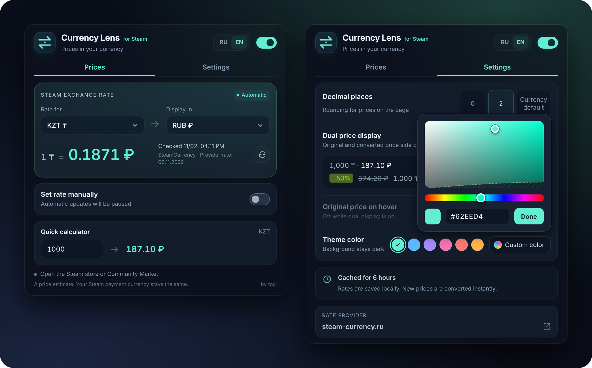

<div align="center">


# Currency Lens for Steam

**A Chrome extension that shows Steam prices in the currency you prefer**




</div>

## Features

- **Automatic conversion** of prices in the Steam Store and on the Community Market, including content that loads dynamically.
- **Dual price display.** The original and converted prices are shown side by side: `1,000 ₸ · 187.10 ₽`. Discounts and struck-through prices are handled too.
- **Original price on hover.** A tooltip shows the original price and the rate used to convert it.
- **Steam's internal exchange rate.** Rates come from [steam-currency.ru](https://steam-currency.ru/), with [PlayWallet](https://playwallet.bot/steam-currency) as a fallback when the site is unavailable.
- **Manual rate** for a chosen currency pair, if you prefer to use your own.
- **Quick calculator** right in the extension popup.
- **Rounding**: 0 or 2 decimal places, or the currency's default.
- **39 Steam currencies**, with the interface in Russian and English.
- **Theme color**: 6 preset colors or any custom color from the palette.

## Installation

The extension is installed from source:

1. Download the latest version from [**Releases**](../../releases/latest) and unzip the archive.
2. Open `chrome://extensions`.
3. Turn on **Developer mode** in the top right corner.
4. Click **Load unpacked** and select the extension folder.
5. Open any page of the [Steam Store](https://store.steampowered.com/).

Chrome 120 or later is required. In Edge, Brave, Opera and Yandex Browser, the unpacked extension is installed the same way, from the extensions page.

## How it works

| Stage | What happens |
| --- | --- |
| Currency detection | The page currency is read from Steam's markup. |
| Fetching the rate | The steam-currency.ru widget first, then the site's rate table, then PlayWallet. |
| Cache | Rates are stored locally for 6 hours. If a request fails, it is retried after 15 minutes, and the last saved rate is used in the meantime. |
| Conversion | Prices on the page are replaced on the fly. The number of converted prices is shown in the extension popup. |

> [!NOTE]
> Converted prices are estimates. The currency Steam charges you in does not change.

<details>
<summary><b>Supported currencies</b></summary>

<br>

`RUB` `KZT` `USD` `EUR` `UAH` `GBP` `BRL` `AUD` `CAD` `JPY` `KRW` `SGD` `CNY` `INR` `ILS` `CHF` `PLN` `NOK` `IDR` `MYR` `PHP` `THB` `VND` `MXN` `NZD` `CLP` `PEN` `COP` `ZAR` `HKD` `TWD` `SAR` `AED` `KWD` `QAR` `CRC` `UYU` `TRY` `ARS`

</details>

## Privacy and permissions

The extension collects no data, uses no analytics and sends no cookies: requests to rate providers are made with `credentials: "omit"`.

| Permission | Why it's needed |
| --- | --- |
| `storage` | Store settings and the rate cache on your computer |
| `alarms` | Refresh the rate when the cache expires |
| `steam-currency.ru`, `steam-rates.playwallet.bot` | Fetch exchange rates |
| `store.steampowered.com`, `steamcommunity.com` | Convert prices on Steam pages |

## Project structure

```
├── manifest.json         Manifest (MV3)
├── background.js         Service worker: fetching rates, cache, retries
├── rate-source.js        Parsing steam-currency.ru and PlayWallet responses
├── content.js            Finding and converting prices on Steam pages
├── content.css           Styles for dual prices on the page
├── price-parser.js       Recognizing prices and amounts
├── shared.js             Currencies, settings, formatting
├── popup.html/.css/.js   Extension popup
├── theme.js              Color themes and palette
├── i18n.js               Interface translations
├── _locales/             Name and description for Chrome
├── icons/                Extension icons
└── docs/images/          Images for the README
```

No build step needed: plain JavaScript with no dependencies.

## Author

Made by [toxi](https://steamcommunity.com/id/itoxi/).
