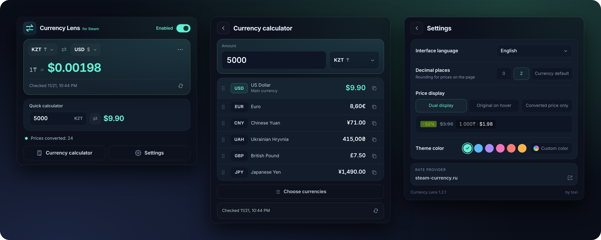
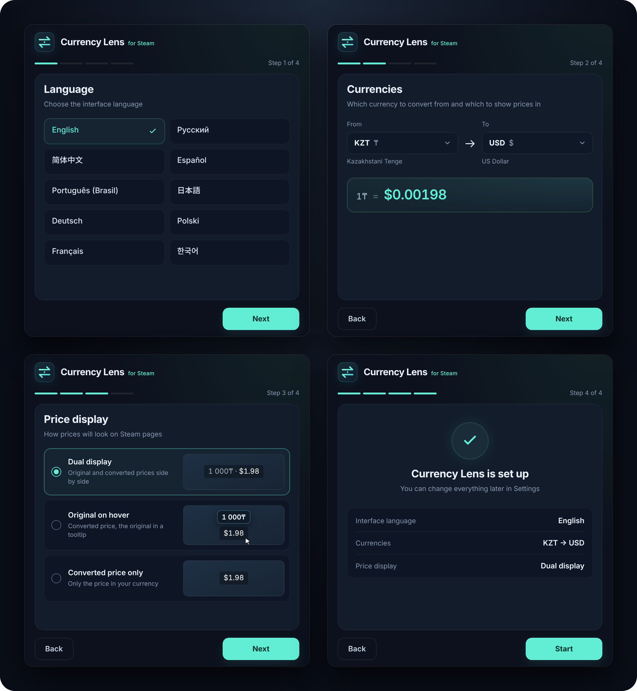

<div align="center">


# Currency Lens for Steam

**A browser extension for Chrome and other Chromium browsers that shows Steam prices in the currency you prefer**




</div>

## Features

- **Automatic conversion** of prices in the Steam Store and on the Community Market, including content that loads dynamically.
- **Steam's own price format** for every currency: `$1.98`, `8,60€`, `1 000,00₸`, `¥1,490`.
- **Steam's internal exchange rate** from [steam-currency.ru](https://steam-currency.ru/), with [PlayWallet](https://playwallet.bot/steam-currency) as a fallback, or a **manual rate** of your own.
- **Quick calculator** on the main screen. The ⇄ button switches the direction, and the default amount is a round sum worth about $10 at the current rate. Clicking an amount selects it, so you can type a new number right away.
- **Currency calculator.** Convert any amount into your main currency and up to six more at once. Drag rows to reorder them and copy any result with one click.
- **Currency search.** Find a currency by code, name or symbol. The ⇄ button next to the currencies swaps them.
- **⋯ menu** on the rate card: switch between an automatic and a manual rate, copy the rate or open the rate provider.
- **Notifications on Steam pages** when a new version is out or when the Steam currency differs from the one set in the extension.
- **Theme color:** six presets or any custom color. The background stays dark, and the toolbar icon follows the theme and turns gray when conversion is off.
- **37 Steam currencies** and **10 interface languages:** English, Русский, 简体中文, Español, Português (Brasil), 日本語, Deutsch, Polski, Français, 한국어.

## On Steam pages

Prices can be shown in three ways, and discounts are handled in each of them:

- **Dual display.** The original and converted prices side by side.
- **Original on hover.** The converted price, with the original in a small tooltip.
- **Converted price only.**

## First launch

A short setup walks you through four steps: interface language, currencies, price display and a summary. The interface language is chosen from your browser's language, and everything can be changed later in Settings.

On the first visit to Steam, a welcome window explains what the extension does and that converted prices are for reference only. Prices are converted after you click **I agree, start using**.

<div align="center">

</div>

## Installation

The extension is installed from source:

1. Download the latest version from [**Releases**](../../releases/latest) and unzip the archive.
2. Open your browser's extensions page (see the table below).
3. Turn on **Developer mode**.
4. Click **Load unpacked** and select the extension folder.

### Supported browsers

The extension works in Chrome 120 or later and in any browser built on the same version of Chromium or newer:

| Browser | Extensions page |
| --- | --- |
| Google Chrome | `chrome://extensions` |
| Microsoft Edge | `edge://extensions` |
| Yandex Browser | `browser://extensions` |
| Opera, Opera GX | `opera://extensions` |
| Brave | `brave://extensions` |
| Vivaldi | `vivaldi://extensions` |
| Arc, Chromium and other Chromium-based browsers | `chrome://extensions` |

Firefox, Safari and mobile browsers are not supported.

## How it works

| Stage | What happens |
| --- | --- |
| Currency detection | The page currency is read from Steam's markup, and each price is recognized by its currency symbol. |
| Fetching the rate | The steam-currency.ru widget first, then the site's rate table, then PlayWallet. |
| Cache | Rates are stored locally for 6 hours. If a request fails, it is retried after 15 minutes, and the last saved rate is used in the meantime. |
| Conversion | Prices on the page are replaced on the fly. The number of converted prices is shown in the popup while a Steam tab is open. |

> [!NOTE]
> Converted prices are estimates. Steam always charges you in your account currency at the price shown in the store.

<details>
<summary><b>Supported currencies</b></summary>

<br>

`RUB` `KZT` `USD` `EUR` `UAH` `GBP` `BRL` `AUD` `CAD` `JPY` `KRW` `SGD` `CNY` `INR` `ILS` `CHF` `PLN` `NOK` `IDR` `MYR` `PHP` `THB` `VND` `MXN` `NZD` `CLP` `PEN` `COP` `ZAR` `HKD` `TWD` `SAR` `AED` `KWD` `QAR` `CRC` `UYU`

</details>

## Privacy and permissions

The extension collects no data, uses no analytics and sends no cookies: every request is made with `credentials: "omit"`.

| Permission or request | Why it's needed |
| --- | --- |
| `storage` | Store settings and the rate cache on your computer |
| `alarms` | Refresh the rate when the cache expires and check for updates once a day |
| `steam-currency.ru`, `steam-rates.playwallet.bot` | Fetch exchange rates |
| `api.github.com` | Check this repository for a new release |
| `store.steampowered.com`, `steamcommunity.com` | Convert prices and show notifications on Steam pages |

## Project structure

```
├── manifest.json         Manifest (MV3)
├── background.js         Service worker: rates, cache, retries, update check, toolbar icon
├── rate-source.js        Parsing steam-currency.ru and PlayWallet responses
├── content.js            Converting prices, tooltips and notifications on Steam pages
├── content.css           Colors for dual prices on the page
├── price-parser.js       Recognizing prices and amounts
├── shared.js             Currencies, price formats, languages, settings
├── popup.html/.css/.js   Extension popup, calculator and first-run setup
├── theme.js              Theme colors, color picker and icon tinting
├── i18n.js               Interface translations
├── _locales/             Extension name and description in 10 languages
├── icons/                Extension icons
├── docs/images/          Images for the README
└── LICENSE               License: PolyForm Strict 1.0.0
```

No build step needed: plain JavaScript with no dependencies.

## License

Currency Lens is released under the [PolyForm Strict License 1.0.0](LICENSE).

You may install and use the extension for any noncommercial purpose. You may not change it, build new works on it, share copies of it or publish it anywhere, including extension stores, and you may not use it commercially. For any other use, contact the author.

## Author

Made by [toxi](https://steamcommunity.com/id/itoxi/). Report bugs and suggest ideas in [Issues](../../issues).
